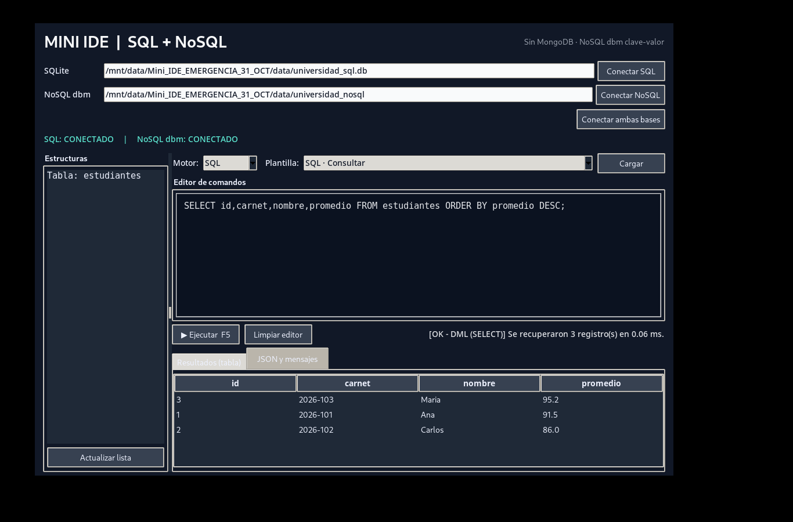
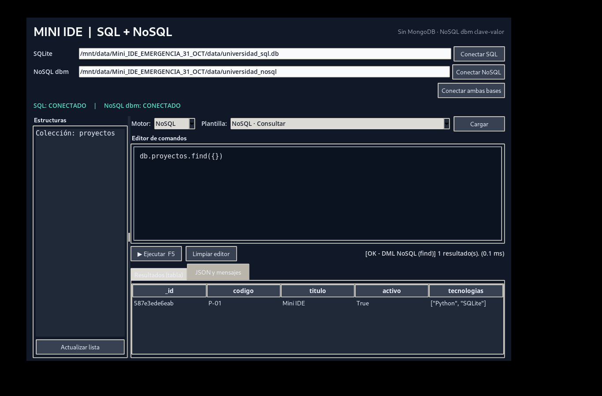

# Mini IDE Híbrido — SQLite + NoSQL dbm (versión de emergencia)

> **Advertencia:** Esta versión usa SQLite3 para SQL y la base persistente clave-valor `dbm.dumb` de Python para NoSQL. **No conecta a MongoDB ni afirma hacerlo.** La interfaz añade operaciones documentales sobre el almacén clave-valor y acepta un subconjunto de sintaxis similar a MongoShell. Es un proyecto local educativo para un único usuario, no un servidor multiusuario.

## Descripción y funciones
Aplicación gráfica de escritorio desarrollada con Python 3 y Tkinter: conexión a dos bases persistentes, editor de instrucciones SQL o NoSQL, ejecución de operaciones sobre estructuras y datos, mensajes de error, visualización de resultados en una tabla y en formato JSON, explorador de tablas y colecciones, atajo F5 y plantillas.

## Tecnologías y versiones
- Python: **3.10 o superior** (verificar con `python --version`; versión utilizada en la demostración: **[COMPLETAR]**).
- Tkinter/ttk: GUI, incluido en muchas instalaciones de Python.
- SQLite3: BD relacional, biblioteca estándar (`SELECT sqlite_version()` muestra la versión local).
- `dbm.dumb`: BD NoSQL persistente de **pares clave/valor**, biblioteca estándar. Documentos JSON almacenados como valores, organizados en colecciones lógicas. **No es MongoDB**.
- Módulos `json`, `sqlite3`, `dbm.dumb`, `uuid`, `tkinter`, `unittest`: estándar; no se requieren paquetes con `pip`.

## Instalar y ejecutar (Windows)
1. Instalar Python desde https://www.python.org/downloads/ y activar **Add python.exe to PATH**. No hay que instalar MongoDB.
2. Extraer este ZIP en una carpeta simple (por ejemplo `C:\MiniIDE`).
3. Doble clic en `INICIAR_WINDOWS.bat`, o en PowerShell:
   ```powershell
   py -3 main.py
   ```
4. En el IDE hacer clic en **Conectar ambas bases** (se conecta también automáticamente al abrir) y verificar las dos etiquetas `CONECTADO`.
5. Elegir una plantilla, pulsar **Cargar** si es necesario y ejecutar con **F5** o el botón.
6. Ver los datos en la pestaña **Resultados (tabla)** y la evidencia documental en **JSON y mensajes**.

## Instalar y ejecutar (Linux)
```bash
python3 main.py
```
En algunas distribuciones es necesario instalar `python3-tk` mediante el gestor de paquetes del sistema.

## Motores y conexiones
- SQL: se abre el archivo `data/universidad_sql.db` y se consulta su versión SQLite. No necesita usuario ni contraseña.
- NoSQL: se abre la base clave-valor `data/universidad_nosql` con el módulo `dbm.dumb`. No necesita servidor ni credenciales; la aplicación reporta errores de archivos/rutas.
- Ambos motores son **embebidos y locales**. Cada uno usa almacenamiento independiente.

## Comandos probados y demostración
Seleccionar las plantillas del IDE **en este orden**:

### SQL — DDL y DML
```sql
CREATE TABLE IF NOT EXISTS estudiantes (
  id INTEGER PRIMARY KEY AUTOINCREMENT,
  carnet TEXT UNIQUE NOT NULL,
  nombre TEXT NOT NULL,
  promedio REAL NOT NULL
);
INSERT OR IGNORE INTO estudiantes(carnet,nombre,promedio) VALUES
 ('2026-101','Ana',91.5), ('2026-102','Carlos',86), ('2026-103','Maria',95.2);
SELECT * FROM estudiantes;
UPDATE estudiantes SET promedio=94 WHERE carnet='2026-102';
SELECT * FROM estudiantes;
DELETE FROM estudiantes WHERE carnet='2026-103';
```
`ALTER TABLE` y `DROP TABLE` también están disponibles en el menú; `ALTER TABLE ... ADD COLUMN semestre` solo debe ejecutarse una vez hasta que se reinicie la tabla.

### NoSQL — operaciones sobre documentos
El intérprete entiende instrucciones JSON y un **subconjunto** de sintaxis tipo MongoShell. Estas expresiones **no se envían a un servidor MongoDB**.
```javascript
db.createCollection("proyectos")
db.proyectos.insertOne({"codigo":"P-01","titulo":"Mini IDE","activo":true})
db.proyectos.find({})
db.proyectos.updateOne({"codigo":"P-01"},{"$set":{"activo":false}})
db.proyectos.find({})
db.proyectos.deleteOne({"codigo":"P-01"})
```
Para repetir la creación de una colección hay que eliminarla antes con `db.dropCollection("proyectos")`. La sintaxis de objetos y listas debe respetar **JSON válido**: claves entre comillas dobles, `true`/`false` en minúscula.

## Capturas de funcionamiento
Las siguientes capturas se generaron ejecutando esta versión en un entorno de prueba con interfaz gráfica, **no en la computadora del alumno**. Antes de entregar, se recomienda reemplazarlas por capturas del equipo con el que se presentará.

**SQL:**


**NoSQL:**


## Estructura
```
mini-ide/
├── main.py                    # Interfaz Tkinter
├── database/
│   ├── sql_manager.py        # SQLite y transacciones
│   └── nosql_manager.py      # NoSQL clave-valor dbm, no MongoDB
├── queries/                   # Secuencias de consulta
├── tests/test_backends.py    # Pruebas de los dos motores
├── assets/                    # Capturas de GUI
├── docs/                      # Informe y guion
├── INICIAR_WINDOWS.bat
├── requirements.txt          # Sin dependencias extra
└── .gitignore
```

## Pruebas automatizadas
```powershell
py -3 -m unittest discover -s tests -v
```
Se cubren: SQL DDL/DML, error de consulta, persistencia al reconectar; NoSQL crear colección, insertar, consultar, actualizar, eliminar, persistencia y manejo de error. Cada prueba usa bases temporales y no modifica las bases de la exposición.

## Decisiones, limitaciones y reflexión
Se eligieron SQLite y un motor clave-valor embebido para construir una demostración sin servidores ni dependencias externas. La principal dificultad fue mantener separada la lógica de los dos modelos y convertir los documentos JSON en resultados tabulares. Se aprendió a gestionar conexiones, transacciones SQL y estructuras documentales. `dbm.dumb` está orientado a prototipos, no es adecuado para varios usuarios simultáneos; tampoco ofrece todo el lenguaje de MongoDB ni funcionalidades avanzadas de consultas. Para un entorno de producción se usaría una base NoSQL dedicada, como MongoDB o Redis.

**Reflexión personal que debe adaptar cada integrante:** [ESCRIBIR 3–4 FRASES SOBRE QUÉ APRENDIÓ REALMENTE].

## Entrega
- Repositorio GitHub público: **[PEGAR ENLACE REAL, NO INVENTAR]**
- Integrantes: **[NOMBRES COMPLETOS Y CARNETS]**
- PDF en Canvas: debe incluir nombres, carnets, arquitectura, capturas, tecnologías y URL pública.

## Fuentes técnicas
- Python `sqlite3`: https://docs.python.org/3/library/sqlite3.html
- Python `dbm`: https://docs.python.org/3/library/dbm.html
- Python `tkinter`: https://docs.python.org/3/library/tkinter.html
